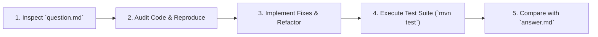

# Spring Boot, Cloud Native & Architecture Assessment Hub

[](https://openjdk.org/)
[](https://spring.io/projects/spring-boot)
[](https://angular.dev/)
[](https://kubernetes.io/)
[](https://www.docker.com/)
[](https://www.postgresql.org/)

A comprehensive, production-grade assessment and study repository designed for mastering **Java 21+**, **Spring Boot 3/4**, **Clean/Hexagonal Architecture**, **Resilience Engineering**, **Microservices & Messaging**, **Angular 17+ Standalone Frontends**, and **Kubernetes** deployments.

---

## 🎯 Repository Purpose & Architecture

This repository is organized into two primary tracks:

1. **Practical Assessment Apps (11 Projects)**: Real-world case study applications featuring deliberate architectural challenges, performance bottlenecks, and bug-hunting exercises. Each project includes a problem checklist (`question.md`) and verified solutions/explanations (`answer.md`).
2. **Mastery Labs & Bootcamps (5 Curriculums)**: In-depth technical tracks focusing on low-level Java performance, comprehensive Spring framework internals, web security reviews, and mock technical interview simulations.

> [!NOTE]
> While this documentation is written in English for portfolio and industry standardisation, specific checklist questions (`question.md`) and technical post-mortems (`answer.md`) inside each subproject may feature Portuguese technical notes matching European engineering interview contexts.

---

## 📁 Track 1: Case Study & Assessment Apps

Hands-on full-stack or backend-focused microservices configured with tests, Docker setups, and Kubernetes manifests.

| Subproject | Domain / Scenario | Key Architectural Patterns & Tech Stack |
| :--- | :--- | :--- |
| [`siemens-prep-app`](siemens-prep-app/) | Self-Service Ticket Portal | **Hexagonal Architecture** (Ports & Adapters), Java 21, Spring Boot 3, Angular 17 Standalone, Flyway, Docker, K8s, GitHub Actions CI |
| [`booking-app`](booking-app/) | Equipment Reservations | **Event-Driven Architecture** (`ApplicationEventPublisher`), JPA Specifications, Concurrency Control & Optimistic Locking, Angular Frontend, K8s |
| [`hr-sync-app`](hr-sync-app/) | HR External Sync Service | **Resilience Engineering** via **Resilience4j** (Circuit Breaker, Exponential Backoff Retry, RateLimiter, Bulkhead, TimeLimiter), Azure integration |
| [`secure-portal-app`](secure-portal-app/) | Secure Auth & RBAC Portal | **Spring Security 6 Stateless JWT Filter Chain**, Method Security (`@PreAuthorize`), Secret key management, CORS & CSRF hardening |
| [`payments-app`](payments-app/) | Payment Processing Gateway | **SOLID Principles Deep Dive** (SRP, OCP, LSP, ISP, DIP refactorings), Anti-pattern detection, zero-DB pure business logic |
| [`request-pipeline-app`](request-pipeline-app/) | HTTP Request Filter Chain | **Servlet Filters vs. HandlerInterceptors**, `MDC` distributed tracing, `ThreadLocal` lifecycle leak prevention, SecurityContext order |
| [`announcements-app`](announcements-app/) | Internal Company Bulletin | **Spring Data JPA Auditing** (`@CreatedBy`, `@LastModifiedDate`), Pagination traps (0-index vs 1-index, `Page` vs `Slice`), Flyway migration versioning |
| [`kb-app`](kb-app/) | Knowledge Base & Articles | **JPA Criteria API & Dynamic Specifications**, Full-text search, Count query optimization, Angular Frontend, K8s |
| [`expenses-app`](expenses-app/) | Corporate Expense Tracker | **Spring Boot REST API**, PostgreSQL, Flyway migrations, Angular 17 Frontend, Kubernetes Manifests |
| [`incidents-app`](incidents-app/) | Incident Management | **State Machine & Lifecycle Transitions**, Audit trails, RESTful API, PostgreSQL, Angular Frontend, K8s |
| [`leave-portal-app`](leave-portal-app/) | Employee Leave Approvals | **Approval Workflow & Validations**, Entity relationships, Business constraints enforcement, Angular Frontend |

---

## 🧪 Track 2: Mastery Bootcamps & Deep-Dive Labs

Specialized modules and deep-dive labs designed to transition from *"I know how to use it"* to *"I understand the JVM internals, design decisions, and tradeoffs"*.

| Lab / Bootcamp | Focus Area | Description & Highlights |
| :--- | :--- | :--- |
| [`java-spring-expert-bootcamp`](java-spring-expert-bootcamp/) | Complete Expert Curriculum (10 Modules) | Progressive curriculum covering Java Core, Advanced concurrency, Spring internals, JPA performance (N+1, batching), Testcontainers, Kafka messaging, Observability, and Capstone project. |
| [`springboot-mastery-lab`](springboot-mastery-lab/) | Spring Boot Enterprise Mastery | Systematic modules covering Spring MVC, Forms, Bean Validation, Data Access, Spring Security, Spring Batch workers, and Cloud integrations. |
| [`java-mastery-pack`](java-mastery-pack/) | Java Performance & Collections | Low-level asymptotic complexity, primitive array in-place algorithms, benchmark comparisons (`ArrayList` vs. `LinkedList`), Stream API collectors, and custom binary search. |
| [`payments-interview-lab`](payments-interview-lab/) | Senior Technical Interview Simulation | End-to-end payment gateway interview challenge simulating high-pressure live coding: idempotent transactions, circuit breakers, and payment reconciliation. |
| [`javascript-security-lab`](javascript-security-lab/) | Application Security & Triage | Web security review lab analyzing OWASP Top 10 vulnerabilities, DOM-based XSS, CSP policies, authentication flaws, and secure code review checklists. |

---

## 🛠️ Prerequisites & Environment Setup

Ensure the following tools are installed in your development environment:

- **Java Development Kit (JDK 21+)** (e.g., Eclipse Temurin, GraalVM, or Amazon Corretto)
- **Node.js (v18+)** and **npm** (for Angular frontends)
- **Docker** & **Docker Compose**
- **Kubernetes CLI (`kubectl`)** along with a local cluster (e.g., Minikube, Kind, or Docker Desktop K8s)
- **Apache Maven 3.9+** (or use bundled `./mvnw` wrappers)

Verify installations:
```bash
java -version
node -v
npm -v
docker --version
kubectl version --client
```

---

## 🚀 Getting Started

Each project is self-contained with its own build configurations and environment settings.

### 1. Running an Assessment Backend (Spring Boot)

Navigate to the backend folder of your target project:

```bash
cd siemens-prep-app/backend
# Or booking-app/backend, hr-sync-app/backend, etc.

# Run database/infrastructure (if docker-compose.yml is provided in the subproject root or backend):
docker compose up -d

# Run the Spring Boot application
./mvnw spring-boot:run
```

To run unit and integration tests:
```bash
./mvnw test
```

### 2. Running an Angular Frontend

Navigate to the frontend folder:

```bash
cd siemens-prep-app/frontend

# Install dependencies
npm install

# Start development server
npm start
```
The application will be accessible at `http://localhost:4200`.

### 3. Deploying to Kubernetes (k8s)

For subprojects with Kubernetes manifests (`k8s/` or `infra/`):

```bash
cd siemens-prep-app
kubectl apply -f k8s/

# Verify deployed resources
kubectl get pods
kubectl get services
```

---

## 💡 Recommended Assessment Workflow

For the case study applications:



1. **Review Challenges**: Open `question.md` in the target folder to view the list of identified bugs, security flaws, architectural violations, or task checklists.
2. **Diagnose & Implement**: Apply fixes following clean code practices, thread-safety, proper exception handling, and resilient design.
3. **Verify**: Ensure all unit and integration tests pass cleanly.
4. **Learn & Compare**: Check `answer.md` to review the architectural rationale, root cause analysis, and alternative solution strategies.

---

## 📜 License & Contribution

This repository is maintained for educational, assessment, and preparation purposes. Contributions, issue discussions, and pull requests for new edge cases or architectural patterns are welcome!
